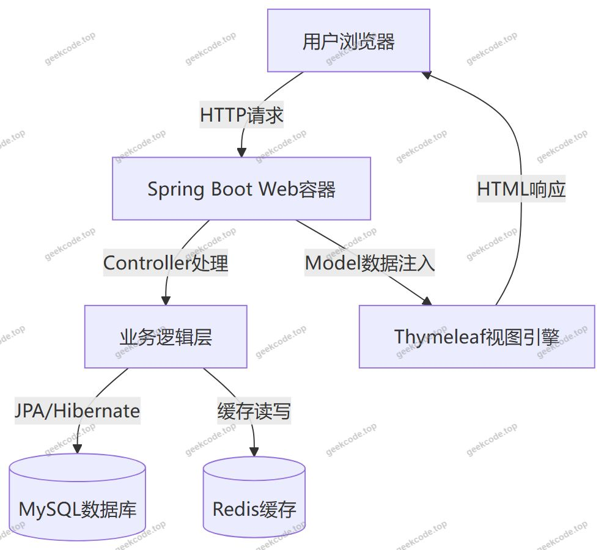
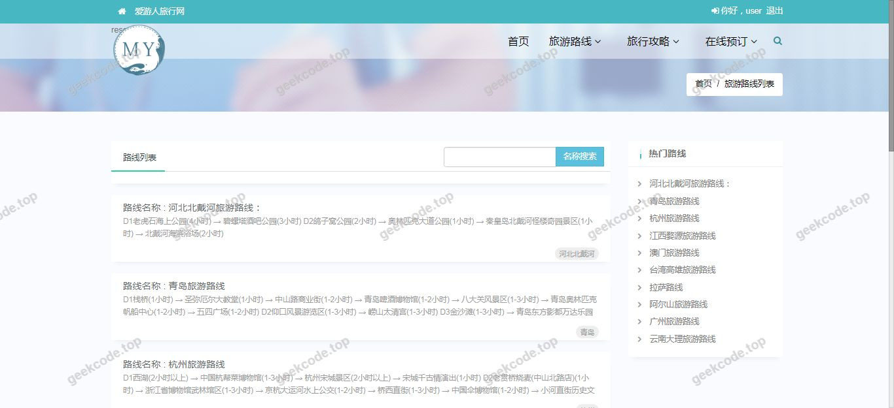
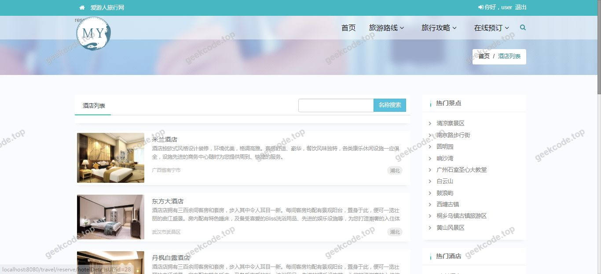
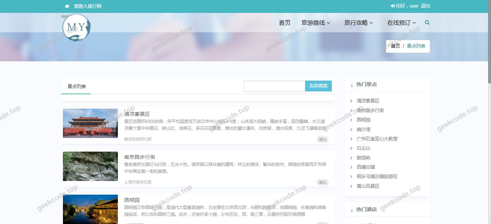
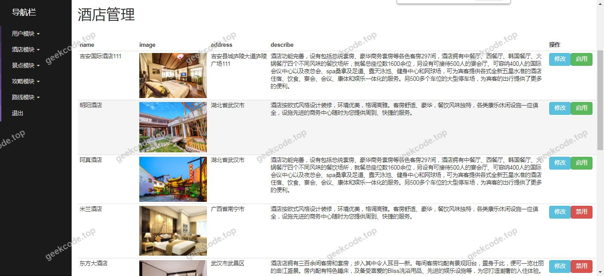
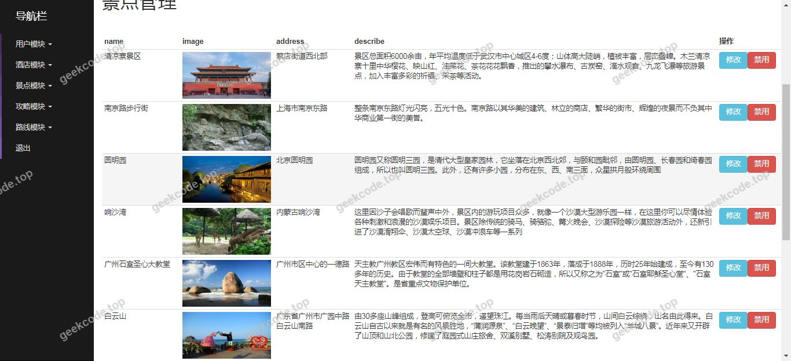
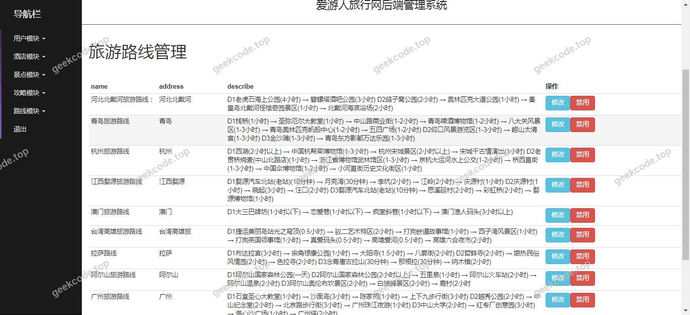

# Java精品项目-基于ssm的前台+后台在线旅游网站系统

> 🎓 **计算机毕业设计 · Java精品项目-基于ssm的前台+后台在线旅游网站系统**
>
> 本仓库只放**项目介绍 + 运行截图**（截图是站点带水印的原图，存在仓库 `images/` 里）。
>
> 👉 **完整可运行源码 / 数据库脚本 / 部署文档：[点我获取](https://geekcode.top/archives/Java%E7%B2%BE%E5%93%81%E9%A1%B9%E7%9B%AE-%E5%9F%BA%E4%BA%8Essm%E7%9A%84%E5%89%8D%E5%8F%B0-%E5%90%8E%E5%8F%B0%E5%9C%A8%E7%BA%BF%E6%97%85%E6%B8%B8%E7%BD%91%E7%AB%99%E7%B3%BB%E7%BB%9F?utm_source=github)**
>
> 💬 咨询微信：**ir9372**　|　🌐 更多项目：[极客代码 geekcode.top](https://geekcode.top/?utm_source=github)
>
> 📌 项目详情页：<https://geekcode.top/archives/Java%E7%B2%BE%E5%93%81%E9%A1%B9%E7%9B%AE-%E5%9F%BA%E4%BA%8Essm%E7%9A%84%E5%89%8D%E5%8F%B0-%E5%90%8E%E5%8F%B0%E5%9C%A8%E7%BA%BF%E6%97%85%E6%B8%B8%E7%BD%91%E7%AB%99%E7%B3%BB%E7%BB%9F?utm_source=github>

<table><td width="230" align="center"> <b>扫码加微信 ir9372</b></td><td valign="middle">📦 源码 = 项目介绍 + 全部运行截图 + 数据库 + 部署文档 👉 点上方任意截图，直接跳到 <b>极客代码 geekcode.top</b> 详情页</td></table>

---

<h1>Java精品项目-基于ssm的前台+后台在线旅游网站系统</h1>
<h2>项目概述</h2>

本项目名为“Java精品项目-基于ssm的前台+后台在线旅游网站系统”，旨在构建一个基于现代Web技术栈的在线旅游服务平台。尽管项目名称中提及“SSM”及“前台+后台”，但根据实际源码配置与运行截图分析，该项目当前主要呈现为前端展示界面（Thymeleaf模板渲染），核心业务逻辑依赖于后端服务支持。项目适用于旅游信息展示、行程浏览等场景，面向普通互联网用户。技术架构采用Spring Boot作为基础框架，结合Redis进行缓存加速，MySQL存储数据，并通过Thymeleaf实现服务端页面渲染。由于提供的上下文未包含具体的路由定义和权限控制代码，目前无法确定其完整的后台管理功能模块细节，主要侧重于前端页面的静态或半动态展示效果验证。

<h2>技术架构</h2>

本项目的技术选型遵循轻量级、高内聚的开发原则，具体架构如下：

<ol>
<li><strong>后端框架</strong>：采用 Spring Boot (spring-boot-starter-web) 作为核心容器，简化了XML配置，实现了快速启动与自动装配。</li>
<li><strong>视图层技术</strong>：使用 Thymeleaf (spring-boot-starter-thymeleaf) 配合 thymeleaf-layout-dialect 进行页面布局与渲染，确保前后端分离下的模板复用性与安全性。</li>
<li><strong>数据持久层</strong>：集成 spring-boot-starter-data-jpa，利用ORM映射机制操作 MySQL 数据库 (mysql-connector-java)，降低SQL编写复杂度。</li>
<li><strong>缓存机制</strong>：引入 spring-boot-starter-data-redis，用于高频访问数据的缓存处理，提升系统响应速度。</li>
<li><strong>工具库</strong>：使用 Lombok 简化实体类代码，Gson 和 Fastjson 处理JSON数据序列化与反序列化，提高开发效率。</li>
</ol>

<h2>功能模块</h2>

根据现有的代码依赖、截图列表以及明确标注的“无前台导航菜单”、“无后台路由”等信息，本项目的功能模块划分如下：

<h3>前台用户端</h3>

根据提供的7张“系统运行界面”截图（front），前台主要体现为页面展示功能。由于缺乏具体路由和功能描述代码，仅能确认以下通用展示能力：

<ol>
<li><strong>首页/主界面展示</strong>：对应截图1-7中的不同页面状态，可能包含轮播图、推荐位、资讯列表等静态或动态内容区域。</li>
<li><strong>模板渲染展示</strong>：基于Thymeleaf引擎，展示由后端传递的数据模型生成的HTML页面。</li>
</ol>

<em>注意：根据现有信息无法确定具体的交互功能（如搜索、预订、登录注册等），因为上下文中未提供相关Controller方法或表单提交接口的定义。</em>

<h3>后台管理端</h3>

根据输入信息，“是否有后台: 否”且“后台路由: (无后台路由)”，因此本项目在当前交付版本中<strong>不包含</strong>可见的后台管理功能模块。所有管理逻辑若存在，均未通过独立的路由暴露在前端或通过文档说明。

<h2>用户角色与权限</h2>

根据现有项目配置与代码上下文，<strong>无法确定</strong>具体的用户角色与权限体系。理由如下：

<ol>
<li>未检测到 <code>spring-boot-starter-security</code> 或其他权限控制框架依赖。</li>
<li>无后台路由定义，意味着不存在管理员登录入口或权限拦截器配置。</li>
<li>个人中心菜单为空，表明未实现基于Session或Token的用户身份识别与个性化展示。</li>
</ol>

因此，当前系统表现为一个开放的、无需身份认证的静态/动态展示平台，所有访问者拥有相同的查看权限。

<h2>项目特色与创新点</h2>
<ol>
<li><strong>经典技术栈组合</strong>：采用 Spring Boot + JPA + Thymeleaf + Redis 的经典组合，兼顾了开发便捷性、数据操作的规范性以及读取性能的优化，适合中小型单体应用快速迭代。</li>
<li><strong>服务端渲染优势</strong>：相较于纯SPA架构，Thymeleaf的服务端渲染有利于SEO优化和首屏加载速度，特别适合旅游资讯类内容的传播。</li>
<li><strong>轻量化设计</strong>：移除复杂的微服务治理组件，聚焦于核心业务展示，降低了运维成本和部署难度。</li>
</ol>

<em>注：由于缺少具体业务功能描述，上述特色主要基于技术选型推导，而非特定业务创新。</em>

<h2>部署环境</h2>

为确保项目正常运行，需准备以下软件环境：

<table>
<thead>
<tr>
<th align="left">组件</th>
<th align="left">版本建议</th>
<th align="left">说明</th>
</tr>
</thead>
<tbody><tr>
<td align="left">JDK</td>
<td align="left">1.8 或 11+</td>
<td align="left">Spring Boot 运行基础环境</td>
</tr>
<tr>
<td align="left">Maven</td>
<td align="left">3.6+</td>
<td align="left">项目构建与依赖管理工具</td>
</tr>
<tr>
<td align="left">MySQL</td>
<td align="left">5.7 或 8.0</td>
<td align="left">关系型数据库，存储业务数据</td>
</tr>
<tr>
<td align="left">Redis</td>
<td align="left">5.0+</td>
<td align="left">缓存服务，需启动本地实例</td>
</tr>
<tr>
<td align="left">IDE</td>
<td align="left">IntelliJ IDEA / Eclipse</td>
<td align="left">开发调试工具</td>
</tr>
</tbody></table>

<strong>部署步骤简述：</strong>

<ol>
<li>安装并配置 JDK 环境变量。</li>
<li>启动 MySQL 服务，创建对应的数据库实例，并执行初始化SQL脚本（若有）。</li>
<li>启动 Redis 服务，默认端口 6379。</li>
<li>修改 <code>application.properties</code> 或 <code>application.yml</code> 中的数据库连接地址、用户名、密码及Redis地址。</li>
<li>使用 Maven 命令 <code>mvn clean package</code> 打包项目。</li>
<li>运行 jar 包：<code>java -jar target/project-name.jar</code>。</li>
<li>浏览器访问 <code>http://localhost:8080</code> 查看前台展示界面。</li>
</ol>
<h2>五、技术特性</h2>
<ul>
<li>服务端模板渲染（Thymeleaf）</li>
<li>使用 Redis 缓存提升系统性能</li>
</ul>
<h2>六、功能模块截图</h2>
<h3>前台用户端</h3>
<h4>系统运行界面1</h4>

<h4>系统运行界面2</h4>

<h4>系统运行界面3</h4>

<h4>系统运行界面4</h4>

<h4>系统运行界面5</h4>

<h4>系统运行界面6</h4>

<h4>系统运行界面7</h4>

---

## 获取完整源码

| 项目 | 说明 |
| --- | --- |
| 项目名 | Java精品项目-基于ssm的前台+后台在线旅游网站系统 |
| 运行截图 | 本文 8 张（站点带水印原图，仓库 `images/` 目录） |
| 完整源码 | [https://geekcode.top/archives/Java%E7%B2%BE%E5%93%81%E9%A1%B9%E7%9B%AE-%E5%9F%BA%E4%BA%8Essm%E7%9A%84%E5%89%8D%E5%8F%B0-%E5%90%8E%E5%8F%B0%E5%9C%A8%E7%BA%BF%E6%97%85%E6%B8%B8%E7%BD%91%E7%AB%99%E7%B3%BB%E7%BB%9F?utm_source=github](https://geekcode.top/archives/Java%E7%B2%BE%E5%93%81%E9%A1%B9%E7%9B%AE-%E5%9F%BA%E4%BA%8Essm%E7%9A%84%E5%89%8D%E5%8F%B0-%E5%90%8E%E5%8F%B0%E5%9C%A8%E7%BA%BF%E6%97%85%E6%B8%B8%E7%BD%91%E7%AB%99%E7%B3%BB%E7%BB%9F?utm_source=github) |
| 咨询微信 | **ir9372**（备注：jingpin-yuanma） |
| 更多项目 | [极客代码 geekcode.top](https://geekcode.top/?utm_source=github) |

> 需要源码、部署、改配置、跑不起来等问题，加微信 ir9372 沟通，说明项目名即可。
